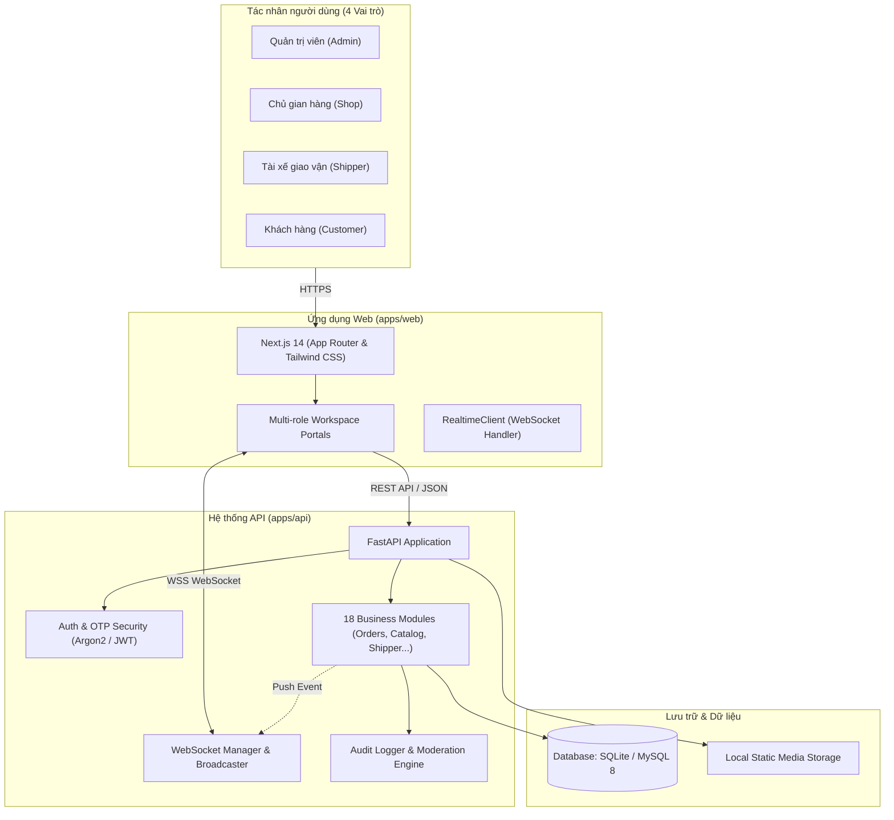

# FreshFlow — Kiến trúc Hệ thống (System Architecture)

## 1. Tổng quan kiến trúc

FreshFlow áp dụng kiến trúc **Modular Monolith** kết hợp **Real-time Gateway** đồng bộ trạng thái hai chiều. Hệ thống vận hành trọn vẹn trong một kho mã nguồn duy nhất (monorepo), chia tách rõ ràng giữa giao diện người dùng (Frontend Web) và dịch vụ xử lý nghiệp vụ trung tâm (Backend API).

---

## 2. Phân lớp Backend (`apps/api`)

- **`app/api/v1`**: Nơi khai báo và đăng ký tập trung toàn bộ router REST (`api/v1/router.py`).
- **`app/api/deps.py`**: Các dependency tiêm phụ thuộc dùng chung: kết nối session CSDL (`get_db`), trích xuất user hiện tại (`get_current_user`), kiểm tra quyền phân quyền (`require_admin`, `require_shop`, `require_shipper`, `require_admin_or_shop`).
- **`app/modules/`**: Kiến trúc phân rã theo miền nghiệp vụ độc lập:
  - `auth`: Xác thực đăng nhập, đăng ký và luồng gửi/xác minh mã OTP.
  - `users`: Quản lý danh sách thành viên, khóa/mở tài khoản, cập nhật hồ sơ Shop/xe Shipper.
  - `catalog`: Danh mục sản phẩm, quản lý ảnh và niêm yết theo Shop.
  - `inventory`: Nhập lô hàng theo ngày, trừ kho và điều chỉnh tồn kho an toàn.
  - `pricing`: Chính sách giá theo nhóm đối tượng (Sinh viên, Người đi làm...).
  - `delivery`: Khung giờ giao hàng và điểm giao tập trung.
  - `orders`: Đặt hàng, tính toán thuế phí tự động, hủy đơn, chuyển trạng thái và cách ly đơn hàng.
  - `shipper`: Nhận đơn giao, cập nhật tiến độ lấy hàng/giao hàng và thu tiền mặt COD.
  - `posts`: Bảng tin Newfeed, quảng bá món trong ngày và giá bán ưu đãi.
  - `reviews`: Đánh giá sản phẩm, đánh giá tài xế và phản hồi của Shop.
  - `chat`: Trò chuyện trực tiếp realtime giữa Khách - Shop - Shipper kèm lọc từ khóa xấu.
  - `vat`: Biểu thuế VAT động và nhật ký biến động thuế.
  - `customer_groups`: Nhóm khách hàng và tỷ lệ chiết khấu.
  - `product_requests`: Đặt hàng mặt hàng riêng biệt và báo giá.
  - `notifications`: Thông báo đẩy và phát sóng thông báo toàn sàn.
  - `moderation`: Bộ lọc từ khóa nhạy cảm và phát hiện vi phạm.
  - `reports`: Báo cáo tài chính, tổng hợp đơn hàng và đối soát doanh thu.
  - `audit_logs`: Ghi vết kiểm toán các thao tác nhạy cảm.
- **`app/realtime`**: Quản lý các kết nối WebSocket, phân luồng sự kiện theo người dùng và phát sóng toàn hệ thống.
- **`app/db`**: Cấu hình kết nối SQLAlchemy Engine, SessionLocal, Base models và kịch bản khởi tạo tự động.

---

## 3. Kiến trúc Frontend (`apps/web`)

- **Framework:** Next.js 14 với App Router và TypeScript đồng bộ kiểu dữ liệu với backend.
- **Routing:**
  - Route công khai: `/login`, `/register`, `/verify`, `/forgot`.
  - Route ứng dụng đa vai trò: `[[...slug]]/page.tsx` tự động nhận diện Role người dùng đăng nhập để hiển thị Portal chuyên biệt:
    - **Admin Dashboard:** Tổng quan doanh thu, tồn kho, đơn hàng, duyệt nội dung, quản lý khách hàng, cấu hình khung giờ giao hàng và báo cáo tài chính.
    - **Shop Portal:** Bảng điều khiển cửa hàng, quản lý gian hàng sản phẩm riêng, đơn hàng phát sinh thuộc shop, điểm giao tập trung và trả lời đánh giá.
    - **Shipper Portal:** Danh sách đơn hàng chờ nhận, đơn đang giao, quy trình nhận hàng, giao hàng và báo cáo thu tiền mặt COD.
    - **Customer Storefront:** Bảng tin Newfeed, duyệt giỏ hàng, chọn khung giờ giao, đặt hàng, gửi yêu cầu sản phẩm, đánh giá và nhắn tin.
- **Realtime Integration:** `RealtimeClient` quản lý vòng đời kết nối WebSocket với cơ chế tự động kết nối lại (auto-reconnect with exponential backoff) và cập nhật state React tức thì.

---

## 4. Cơ chế Cách ly Dữ liệu (Multi-tenant Shop Isolation)

Hệ thống đảm bảo tính toàn vẹn và bảo mật dữ liệu giữa các cửa hàng đối tác:
- **Truy vấn Đơn hàng (`Order.shop_id == user.id`):** Cửa hàng chỉ truy cập được các đơn hàng chứa sản phẩm do chính cửa hàng mình cung cấp.
- **Truy vấn Đánh giá (`Product.shop_id == shop.id`):** Chỉ xem và phản hồi đánh giá đối với các mặt hàng thuộc quyền quản lý của shop.
- **Kiểm soát Tác vụ:** Chặn hoàn toàn hành vi cập nhật trạng thái đơn hàng hoặc phân công Shipper nếu đơn không thuộc shop quản lý (trả về mã lỗi `403 Forbidden`).
- **Bảng tin Newfeed:** Chỉ tác giả (`post.author_id == user.id`) hoặc Quản trị viên mới có quyền sửa/xóa bài đăng.

---

## 5. Môi trường Thực thi & Triển khai

1. **Phát triển Cục bộ (Local Dev):**
   - Backend: Python Virtualenv (`fastapi dev` hoặc `uvicorn app.main:app --port 8000`). Cơ sở dữ liệu SQLite cục bộ `freshflow.db`.
   - Frontend: Node.js 20 (`npm run dev -- -p 3000`).
2. **Triển khai Container (Docker Compose):**
   - File cấu hình [compose.yaml](file:///c:/Users/LEGION/Downloads/FreshFlow/compose.yaml) khởi chạy đồng bộ 3 dịch vụ: CSDL MySQL 8.4, FastAPI Backend container và Next.js Frontend container kết nối qua mạng nội bộ Docker.
