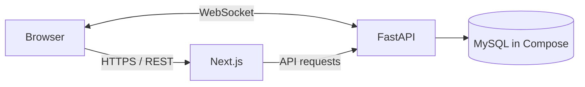

# FreshFlow — Kiến trúc

## Tổng quan

Repository chứa ứng dụng web Next.js tại `apps/web` và API FastAPI tại `apps/api`. Backend tổ chức theo modular monolith; MySQL được khai báo trong `compose.yaml`. Cùng tiến trình API hiện phục vụ REST và WebSocket.

## Phân lớp backend

- `app/api/v1`: đăng ký các REST router; `app/api/deps.py`: dependency dùng chung.
- `app/modules`: nghiệp vụ được chia theo miền như auth, catalog, inventory, orders và delivery.
- `app/db`: engine, session và base model.
- `app/realtime`: endpoint WebSocket.
- `migrations`: migration Alembic.

## Frontend

`apps/web/src/app` chứa route Next.js; `features` chứa màn hình theo nghiệp vụ; `components`, `hooks`, `lib`, `types` và `styles` dùng chung. URL API/WebSocket được cấu hình bằng biến môi trường phía web.

## Dữ liệu và luồng đơn hàng

Backend là nguồn xác thực cho quyền, giá và tồn kho. Khi xử lý đặt/duyệt đơn, nghiệp vụ đơn hàng phối hợp với tồn kho để tránh chấp nhận vượt lượng còn lại. Chi tiết bảng nằm trong `database.md`; endpoint ở `api-spec.md`.

## Chạy local

`docker compose up --build` khởi chạy MySQL, API và web. Cấu hình mặc định trong Compose dành cho phát triển; thay secrets và cấu hình môi trường trước khi triển khai.

## Giới hạn đã biết

Kiến trúc hiện tại chưa chứng minh khả năng chịu tải mục tiêu, tính sẵn sàng nhiều instance hay vận hành production. Cần kiểm thử tải và thiết kế triển khai riêng trước khi đưa ra cam kết.
