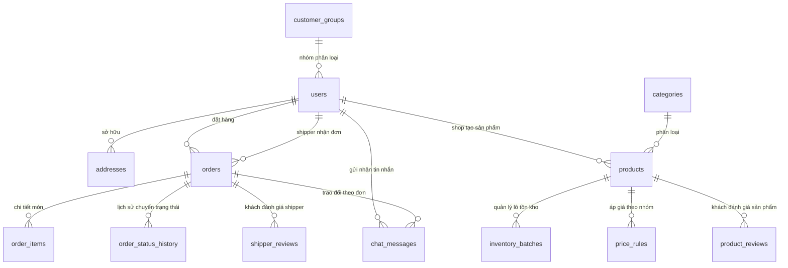

# FreshFlow - Kiến trúc Cơ sở Dữ liệu (Database Schema)

Tài liệu chi tiết cấu trúc cơ sở dữ liệu nền tảng FreshFlow, đồng bộ 100% với các SQLAlchemy Models tại `apps/api/app/models.py`.

- **Hệ quản trị CSDL hỗ trợ:** SQLite 3 (phát triển cục bộ) và MySQL 8.x / MariaDB (môi trường triển khai).
- **Quy ước kiểu:**
  - `PK`: Primary Key (Khóa chính tự tăng).
  - `FK`: Foreign Key (Khóa ngoại ràng buộc quan hệ).
  - `UQ`: Unique (Giá trị duy nhất).
  - `NUMERIC(p, s)`: Kiểu số chính xác dùng cho giá tiền và khối lượng hàng hóa.
  - `DATETIME WITH TIME ZONE`: Mốc thời gian lưu chuẩn UTC.

---

## 1. Sơ đồ Quan hệ Thực thể (ERD Overview)

---

## 2. Chi tiết các Bảng Dữ liệu

### 2.1. Phân quyền & Người dùng (Users & Groups)

#### Bảng `users`
Lưu trữ toàn bộ tài khoản người dùng với 4 vai trò chính: `ADMIN`, `SHOP`, `SHIPPER`, `CUSTOMER`.

| Cột | Kiểu | Ràng buộc / Mặc định | Mô tả |
|---|---|---|---|
| `id` | INTEGER | PK | Mã định danh người dùng |
| `email` | VARCHAR(254) | NOT NULL, UQ, Index | Email đăng nhập |
| `full_name` | VARCHAR(120) | NOT NULL | Họ và tên |
| `password_hash` | VARCHAR(255) | NOT NULL | Mật khẩu băm (Argon2 / Bcrypt) |
| `role` | VARCHAR(20) | NOT NULL, Default `CUSTOMER`, Index | Vai trò: `ADMIN`, `SHOP`, `SHIPPER`, `CUSTOMER` |
| `customer_group` | VARCHAR(30) | NOT NULL, Default `STUDENT` | Nhóm khách hàng: `STUDENT`, `WORKING`, v.v. |
| `phone` | VARCHAR(30) | NULL, UQ | Số điện thoại liên hệ |
| `shop_name` | VARCHAR(160) | NULL | Tên cửa hàng (áp dụng cho role SHOP) |
| `shop_description`| TEXT | NULL | Mô tả giới thiệu cửa hàng |
| `shop_address` | VARCHAR(255) | NULL | Địa chỉ gian hàng |
| `vehicle_info` | VARCHAR(120) | NULL | Biển số / Loại xe (áp dụng cho role SHIPPER) |
| `is_active` | BOOLEAN | NOT NULL, Default `true` | Trạng thái tài khoản |
| `is_email_verified`| BOOLEAN | NOT NULL, Default `false` | Đã xác thực OTP qua Email |
| `is_phone_verified`| BOOLEAN | NOT NULL, Default `false` | Đã xác thực OTP qua Số điện thoại |
| `created_at` | DATETIME | NOT NULL | Thời điểm tạo tài khoản |

#### Bảng `customer_groups`
Chính sách nhóm khách hàng để áp dụng chiết khấu và giá riêng biệt.

| Cột | Kiểu | Ràng buộc / Mặc định | Mô tả |
|---|---|---|---|
| `id` | INTEGER | PK | Mã nhóm |
| `code` | VARCHAR(30) | NOT NULL, UQ, Index | Mã code nhóm (`STUDENT`, `WORKING`, `GROUP_A`...) |
| `name` | VARCHAR(100) | NOT NULL | Tên hiển thị nhóm |
| `description` | TEXT | NULL | Mô tả ưu đãi |
| `discount_percent`| NUMERIC(5, 2)| NOT NULL, Default `0.00` | Tỷ lệ giảm giá mặc định (%) |
| `is_active` | BOOLEAN | NOT NULL, Default `true` | Đang áp dụng hay tạm khóa |

#### Bảng `addresses`
Sổ địa chỉ nhận hàng của khách hàng.

| Cột | Kiểu | Ràng buộc / Mặc định | Mô tả |
|---|---|---|---|
| `id` | INTEGER | PK | Mã địa chỉ |
| `user_id` | INTEGER | FK `users.id` (CASCADE) | Chủ sở hữu địa chỉ |
| `label` | VARCHAR(50) | NOT NULL, Default `Nhà` | Nhãn phân loại (Nhà riêng, Cơ quan, KTX...) |
| `recipient` | VARCHAR(120) | NOT NULL | Tên người nhận hàng |
| `phone` | VARCHAR(30) | NOT NULL | Số điện thoại người nhận |
| `line1` | VARCHAR(255) | NOT NULL | Địa chỉ chi tiết (số nhà, tên đường) |
| `ward` | VARCHAR(100) | NOT NULL, Default `""` | Phường / Xã |
| `district` | VARCHAR(100) | NOT NULL, Default `""` | Quận / Huyện |
| `city` | VARCHAR(100) | NOT NULL | Tỉnh / Thành phố |
| `is_default` | BOOLEAN | NOT NULL, Default `false` | Đặt làm địa chỉ mặc định |

---

### 2.2. Danh mục, Sản phẩm, Tồn kho & Khung giờ giao hàng

#### Bảng `categories`
Phân loại các nhóm nông sản thực phẩm.

| Cột | Kiểu | Ràng buộc / Mặc định | Mô tả |
|---|---|---|---|
| `id` | INTEGER | PK | Mã danh mục |
| `name` | VARCHAR(100) | NOT NULL, UQ | Tên danh mục (Rau củ, Trái cây, Thực phẩm...) |
| `is_active` | BOOLEAN | NOT NULL, Default `true` | Kích hoạt |

#### Bảng `products`
Danh mục sản phẩm, hỗ trợ đa gian hàng (Multi-shop).

| Cột | Kiểu | Ràng buộc / Mặc định | Mô tả |
|---|---|---|---|
| `id` | INTEGER | PK | Mã sản phẩm |
| `category_id` | INTEGER | NULL, FK `categories.id` | Thuộc danh mục |
| `shop_id` | INTEGER | NULL, FK `users.id`, Index | Cửa hàng sở hữu (NULL là sản phẩm của Sàn) |
| `name` | VARCHAR(180) | NOT NULL, Index | Tên sản phẩm nông sản |
| `description` | TEXT | NOT NULL, Default `""` | Mô tả chi tiết |
| `unit` | VARCHAR(30) | NOT NULL, Default `kg` | Đơn vị tính (kg, bó, nải, hộp...) |
| `image_url` | VARCHAR(500) | NULL | Đường dẫn ảnh đại diện |
| `images` | TEXT | NOT NULL, Default `""` | Danh sách nhiều ảnh (JSON hoặc phân cách phẩy) |
| `attached_services`| TEXT | NOT NULL, Default `""` | Dịch vụ kèm theo (nhặt rau, gọt sẵn...) |
| `base_price` | NUMERIC(12, 2)| NOT NULL, Default `0.00` | Giá niêm yết cơ bản |
| `is_active` | BOOLEAN | NOT NULL, Default `true`, Index | Đang kinh doanh |
| `created_at` | DATETIME | NOT NULL | Ngày tạo |

#### Bảng `inventory_batches`
Quản lý các đợt/lô hàng thu hoạch theo ngày để kiểm soát tồn kho thực tế.

| Cột | Kiểu | Ràng buộc / Mặc định | Mô tả |
|---|---|---|---|
| `id` | INTEGER | PK | Mã lô hàng |
| `product_id` | INTEGER | NOT NULL, FK `products.id` | Sản phẩm tương ứng |
| `batch_date` | DATETIME | NOT NULL, Index | Ngày thu hoạch / xuất bán |
| `initial_quantity` | NUMERIC(12, 3)| NOT NULL | Số lượng nhập kho ban đầu |
| `approved_quantity`| NUMERIC(12, 3)| NOT NULL, Default `0.000` | Số lượng đã bán và duyệt vào đơn |
| `is_open` | BOOLEAN | NOT NULL, Default `true` | Đợt hàng còn mở bán hay đã chốt |

#### Bảng `price_rules`
Chính sách bảng giá áp riêng cho từng nhóm khách hàng (Sinh viên, Người đi làm...).

| Cột | Kiểu | Ràng buộc / Mặc định | Mô tả |
|---|---|---|---|
| `id` | INTEGER | PK | Mã quy tắc giá |
| `product_id` | INTEGER | NOT NULL, FK `products.id` | Sản phẩm áp dụng |
| `customer_group` | VARCHAR(30) | NOT NULL | Mã nhóm (`STUDENT`, `WORKING`...) |
| `unit_price` | NUMERIC(12, 2)| NOT NULL | Đơn giá ưu đãi dành riêng cho nhóm |

#### Bảng `delivery_slots`
Cấu hình các khung giờ giao hàng và điểm giao tập trung.

| Cột | Kiểu | Ràng buộc / Mặc định | Mô tả |
|---|---|---|---|
| `id` | INTEGER | PK | Mã khung giờ |
| `name` | VARCHAR(100) | NOT NULL | Tên hiển thị (Ví dụ: `KTX Khu A · 11:30 - 12:30`) |
| `customer_group` | VARCHAR(30) | NOT NULL, Default `ALL` | Nhóm áp dụng (`ALL`, `STUDENT`, `WORKING`) |
| `fee` | NUMERIC(12, 2)| NOT NULL, Default `0.00` | Phí giao hàng (0đ nếu miễn phí/tập trung) |
| `is_active` | BOOLEAN | NOT NULL, Default `true` | Đang mở cho khách chọn |

---

### 2.3. Đơn hàng & Giao vận (Orders & Delivery)

#### Bảng `orders`
Bảng quản lý đơn hàng trung tâm kết nối Người mua, Cửa hàng và Shipper.

| Cột | Kiểu | Ràng buộc / Mặc định | Mô tả |
|---|---|---|---|
| `id` | INTEGER | PK | Mã đơn nội bộ |
| `order_number` | VARCHAR(36) | NOT NULL, UQ, Index | Mã vận đơn (Ví dụ: `FF-261108-A1B2C3`) |
| `user_id` | INTEGER | NOT NULL, FK `users.id`, Index | Khách hàng đặt mua |
| `shop_id` | INTEGER | NULL, FK `users.id`, Index | Cửa hàng chịu trách nhiệm xử lý |
| `shipper_id` | INTEGER | NULL, FK `users.id`, Index | Tài xế nhận đơn giao |
| `status` | VARCHAR(30) | NOT NULL, Index | Trạng thái (`PENDING`, `CONFIRMED`, `PREPARING`, `READY_FOR_PICKUP`, `DELIVERING`, `COMPLETED`, `CANCELLED`) |
| `delivery_type` | VARCHAR(20) | NOT NULL, Default `PICKUP` | `PICKUP` (tập trung) hoặc `HOME` (giao tận nơi) |
| `delivery_address` | TEXT | NOT NULL, Default `""` | Địa chỉ giao tận nơi |
| `recipient_name` | VARCHAR(120) | NOT NULL, Default `""` | Tên người nhận |
| `recipient_phone`| VARCHAR(30) | NOT NULL, Default `""` | Số điện thoại người nhận |
| `expected_delivery_time` | VARCHAR(100) | NOT NULL, Default `""` | Khung giờ giao hàng đã chọn |
| `subtotal` | NUMERIC(12, 2)| NOT NULL, Default `0.00` | Tiền hàng trước thuế & phí |
| `vat_rate` | NUMERIC(5, 4)| NOT NULL, Default `0.0800` | Thuế suất VAT áp dụng (8%) |
| `vat_amount` | NUMERIC(12, 2)| NOT NULL, Default `0.00` | Tiền thuế VAT |
| `delivery_fee` | NUMERIC(12, 2)| NOT NULL, Default `0.00` | Cước phí giao hàng |
| `discount_amount`| NUMERIC(12, 2)| NOT NULL, Default `0.00` | Số tiền giảm giá |
| `total` | NUMERIC(12, 2)| NOT NULL | Tổng tiền đơn hàng thanh toán |
| `paid_amount` | NUMERIC(12, 2)| NOT NULL, Default `0.00` | Số tiền đã thanh toán |
| `debt_amount` | NUMERIC(12, 2)| NOT NULL, Default `0.00` | Công nợ còn lại |
| `payment_status` | VARCHAR(30) | NOT NULL, Default `UNPAID` | Trạng thái thanh toán (`UNPAID`, `PAID`, `PARTIAL`) |
| `payment_method` | VARCHAR(30) | NOT NULL, Default `COD` | Phương thức (`COD`, `BANK_TRANSFER`, `WALLET`) |
| `cash_collected_by_shipper` | NUMERIC(12, 2)| NOT NULL, Default `0.00` | Số tiền mặt Shipper đã thu hộ COD |
| `note` | TEXT | NULL | Ghi chú từ khách hàng |
| `created_at` | DATETIME | NOT NULL, Index | Ngày đặt hàng |
| `updated_at` | DATETIME | NOT NULL | Cập nhật lần cuối |

#### Bảng `order_items`
Chi tiết từng sản phẩm trong đơn hàng.

| Cột | Kiểu | Ràng buộc / Mặc định | Mô tả |
|---|---|---|---|
| `id` | INTEGER | PK | Mã dòng sản phẩm |
| `order_id` | INTEGER | NOT NULL, FK `orders.id` (CASCADE), Index | Thuộc đơn hàng |
| `product_id` | INTEGER | NOT NULL, FK `products.id` | Sản phẩm mua |
| `batch_id` | INTEGER | NOT NULL, FK `inventory_batches.id` | Trừ vào lô tồn kho nào |
| `product_name_snapshot` | VARCHAR(180) | NOT NULL | Tên sản phẩm tại thời điểm mua |
| `unit_snapshot` | VARCHAR(30) | NOT NULL | Đơn vị tính tại thời điểm mua |
| `quantity` | NUMERIC(12, 3)| NOT NULL | Số lượng mua |
| `unit_price` | NUMERIC(12, 2)| NOT NULL | Đơn giá thực thu |
| `line_total` | NUMERIC(12, 2)| NOT NULL | Thành tiền (`quantity * unit_price`) |

#### Bảng `order_status_history`
Nhật ký chuyển trạng thái phục vụ kiểm toán và theo dõi lộ trình đơn.

| Cột | Kiểu | Ràng buộc / Mặc định | Mô tả |
|---|---|---|---|
| `id` | INTEGER | PK | Mã nhật ký |
| `order_id` | INTEGER | NOT NULL, FK `orders.id` (CASCADE), Index | Đơn hàng tương ứng |
| `changed_by` | INTEGER | NOT NULL, FK `users.id` | Người thực hiện cập nhật |
| `old_status` | VARCHAR(30) | NOT NULL | Trạng thái trước |
| `new_status` | VARCHAR(30) | NOT NULL | Trạng thái mới |
| `note` | TEXT | NOT NULL, Default `""` | Lý do / Ghi chú bước chuyển |
| `created_at` | DATETIME | NOT NULL | Thời điểm thay đổi |

---

### 2.4. Đánh giá, Bảng tin & Trò chuyện (Reviews, Posts & Chat)

#### Bảng `product_reviews`
Đánh giá chất lượng sản phẩm từ khách hàng đã mua và nhận hàng thành công.

| Cột | Kiểu | Ràng buộc / Mặc định | Mô tả |
|---|---|---|---|
| `id` | INTEGER | PK | Mã đánh giá |
| `product_id` | INTEGER | NOT NULL, FK `products.id`, Index | Sản phẩm được đánh giá |
| `user_id` | INTEGER | NOT NULL, FK `users.id`, Index | Khách hàng đánh giá |
| `order_id` | INTEGER | NULL, FK `orders.id` | Đơn hàng đã mua |
| `rating` | INTEGER | NOT NULL (1-5 sao) | Điểm đánh giá |
| `comment` | TEXT | NOT NULL, Default `""` | Nhận xét chi tiết |
| `images` | TEXT | NOT NULL, Default `""` | Ảnh phản hồi thực tế |
| `shop_reply` | TEXT | NULL | Phản hồi của Cửa hàng |
| `is_hidden` | BOOLEAN | NOT NULL, Default `false` | Bị ẩn bởi Quản trị viên |
| `created_at` | DATETIME | NOT NULL | Thời điểm gửi đánh giá |

#### Bảng `shipper_reviews`
Đánh giá chất lượng phục vụ của Tài xế giao hàng.

| Cột | Kiểu | Ràng buộc / Mặc định | Mô tả |
|---|---|---|---|
| `id` | INTEGER | PK | Mã đánh giá |
| `shipper_id` | INTEGER | NOT NULL, FK `users.id`, Index | Tài xế nhận đánh giá |
| `user_id` | INTEGER | NOT NULL, FK `users.id`, Index | Khách hàng đánh giá |
| `order_id` | INTEGER | NOT NULL, FK `orders.id`, Index | Đơn hàng giao nhận |
| `rating` | INTEGER | NOT NULL (1-5 sao) | Điểm tổng quát |
| `attitude_rating` | INTEGER | NOT NULL, Default `5` | Đánh giá thái độ phục vụ |
| `speed_rating` | INTEGER | NOT NULL, Default `5` | Đánh giá tốc độ giao hàng |
| `comment` | TEXT | NOT NULL, Default `""` | Nhận xét chi tiết |
| `created_at` | DATETIME | NOT NULL | Thời điểm gửi |

#### Bảng `posts`
Bài viết Newfeed quảng bá nông sản tươi ngon, món ăn theo ngày và chính sách giá nhóm.

| Cột | Kiểu | Ràng buộc / Mặc định | Mô tả |
|---|---|---|---|
| `id` | INTEGER | PK | Mã bài viết |
| `author_id` | INTEGER | NOT NULL, FK `users.id`, Index | Tác giả (Shop hoặc Admin) |
| `product_id` | INTEGER | NULL, FK `products.id` | Liên kết sản phẩm |
| `title` | VARCHAR(255) | NOT NULL | Tiêu đề bài viết |
| `content` | TEXT | NOT NULL | Nội dung chia sẻ |
| `post_type` | VARCHAR(50) | NOT NULL, Default `DAILY_DISH` | Thể loại: `DAILY_DISH`, `PROMOTION`, `NEWS` |
| `image_urls` | TEXT | NOT NULL, Default `""` | Ảnh bài đăng |
| `sale_price` | NUMERIC(12, 2)| NULL | Giá bán ưu đãi |
| `group_prices`| TEXT | NOT NULL, Default `""` | Bảng giá theo nhóm (JSON format) |
| `delivery_time_text`| VARCHAR(120)| NOT NULL, Default `""` | Thời gian giao dự kiến |
| `is_active` | BOOLEAN | NOT NULL, Default `true`, Index | Hiển thị trên bảng tin |
| `created_at` | DATETIME | NOT NULL, Index | Ngày đăng |

#### Bảng `chat_messages`
Tin nhắn trò chuyện thời gian thực giữa Khách hàng, Cửa hàng và Shipper.

| Cột | Kiểu | Ràng buộc / Mặc định | Mô tả |
|---|---|---|---|
| `id` | INTEGER | PK | Mã tin nhắn |
| `sender_id` | INTEGER | NOT NULL, FK `users.id`, Index | Người gửi |
| `receiver_id` | INTEGER | NULL, FK `users.id`, Index | Người nhận riêng |
| `order_id` | INTEGER | NULL, FK `orders.id`, Index | Gắn với đơn hàng cụ thể |
| `content` | TEXT | NOT NULL | Nội dung tin nhắn |
| `image_url` | VARCHAR(500) | NULL | File ảnh đính kèm |
| `is_read` | BOOLEAN | NOT NULL, Default `false` | Đã xem |
| `created_at` | DATETIME | NOT NULL | Thời gian gửi |

---

### 2.5. Thuế VAT, Yêu cầu, Thông báo & Kiểm duyệt

#### Bảng `vat_configs` & `vat_history`
Cấu hình biểu thuế VAT và lưu vết kiểm toán thay đổi mức thuế.

| Bảng | Cột chính | Mô tả |
|---|---|---|
| `vat_configs` | `id`, `tax_name`, `rate` (NUMERIC 5,4), `category_id`, `is_active`, `updated_at` | Thuế suất VAT theo ngành hàng hoặc mặc định toàn sàn |
| `vat_history` | `id`, `tax_name`, `old_rate`, `new_rate`, `changed_by`, `note`, `created_at` | Lịch sử các lần đổi thuế VAT |

#### Bảng `product_requests`
Khách hàng gửi yêu cầu tìm nguồn nông sản đặc thù và Admin/Shop báo giá.

| Cột | Kiểu | Ràng buộc / Mặc định | Mô tả |
|---|---|---|---|
| `id` | INTEGER | PK | Mã yêu cầu |
| `user_id` | INTEGER | NOT NULL, FK `users.id`, Index | Khách hàng yêu cầu |
| `product_name` | VARCHAR(180) | NOT NULL | Tên mặt hàng cần tìm |
| `description` | TEXT | NOT NULL, Default `""` | Mô tả số lượng, chủng loại |
| `status` | VARCHAR(20) | NOT NULL, Default `OPEN`, Index | `OPEN`, `QUOTED`, `ACCEPTED`, `REJECTED`, `FULFILLED` |
| `quoted_price` | NUMERIC(12, 2)| NULL | Mức giá được báo cho khách |
| `admin_response`| TEXT | NOT NULL, Default `""` | Phản hồi của quản trị viên |
| `created_at` | DATETIME | NOT NULL | Ngày tạo |

#### Bảng `notifications`
Hệ thống thông báo đẩy tới từng tài khoản người dùng.

| Cột | Kiểu | Ràng buộc / Mặc định | Mô tả |
|---|---|---|---|
| `id` | INTEGER | PK | Mã thông báo |
| `user_id` | INTEGER | NOT NULL, FK `users.id`, Index | Người nhận |
| `title` | VARCHAR(160) | NOT NULL | Tiêu đề |
| `body` | TEXT | NOT NULL | Nội dung chi tiết |
| `event_type` | VARCHAR(50) | NOT NULL, Default `system` | Loại sự kiện (`order.new`, `order.status_changed`, `system`...) |
| `is_read` | BOOLEAN | NOT NULL, Default `false` | Đã đọc hay chưa |
| `created_at` | DATETIME | NOT NULL | Ngày gửi |

#### Bảng `moderation_terms` & `moderation_violations`
Bộ lọc từ khóa tiêu chuẩn cộng đồng và ghi vết vi phạm trong chat / bài đăng.

| Bảng | Cột chính | Mô tả |
|---|---|---|
| `moderation_terms` | `id`, `term` (VARCHAR 100 UQ), `is_active`, `created_at` | Danh sách đen các từ ngữ tục tĩu, spam, vi phạm |
| `moderation_violations` | `id`, `user_id`, `matched_term`, `created_at` | Nhật ký ghi nhận các lần thành viên vi phạm |

#### Bảng `audit_logs`
Nhật ký kiểm toán toàn bộ hành vi quan trọng của quản trị viên và hệ thống.

| Cột | Kiểu | Ràng buộc / Mặc định | Mô tả |
|---|---|---|---|
| `id` | INTEGER | PK | Mã kiểm toán |
| `actor_id` | INTEGER | NOT NULL, FK `users.id` | Người thực hiện hành vi |
| `action` | VARCHAR(80) | NOT NULL, Index | Tên hành động (`product.created`, `order.updated`...) |
| `entity_type` | VARCHAR(60) | NOT NULL | Thực thể tác động (`product`, `order`, `vat`...) |
| `entity_id` | VARCHAR(60) | NOT NULL | Mã định danh thực thể |
| `details` | TEXT | NOT NULL, Default `""` | Dữ liệu chi tiết |
| `created_at` | DATETIME | NOT NULL | Thời điểm thực hiện |
