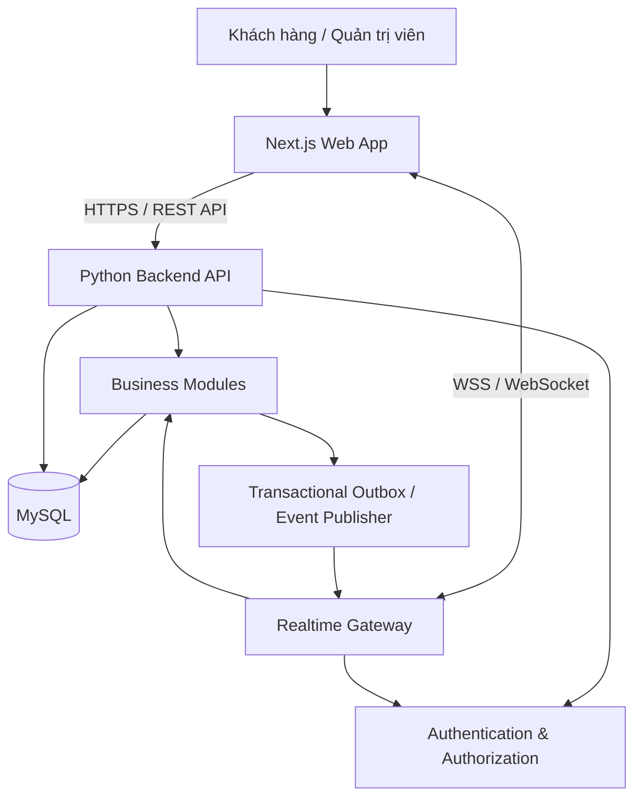

# FreshFlow
## Real-time Inventory & Order Management Platform

> **Đề tài báo cáo:** Xây dựng hệ thống quản lý tồn kho và đặt hàng trực tuyến theo thời gian thực  
> **Tên tiếng Anh:** Development of a Real-time Inventory and Online Ordering Management System  
> **Repository:** `freshflow`  
> **Trạng thái:** Đang ở giai đoạn phân tích yêu cầu và thiết kế kiến trúc

FreshFlow là hệ thống web quản lý và phân phối hàng hóa theo ngày. Quản trị viên quản lý sản phẩm, giá theo nhóm khách hàng, số lượng hàng có thể cung cấp, đơn hàng, yêu cầu mặt hàng, giao hàng, tài khoản, kiểm duyệt nội dung và báo cáo. Khách hàng đăng ký, xác minh tài khoản, xem hàng còn lại, đặt nhiều sản phẩm trong một đơn, gửi yêu cầu mặt hàng và chat với người bán.

Mục tiêu của hệ thống là cung cấp dữ liệu nhất quán, cập nhật gần thời gian thực và có thể triển khai thực tế. Mục tiêu tải ban đầu là **1.000–2.000 người dùng hoạt động đồng thời**, cần được xác minh bằng kiểm thử tải trên hạ tầng triển khai cụ thể.

---

## 1. Nguyên tắc kiến trúc

### 1.1. Modular Monolith + Real-time Gateway

Dùng kiến trúc **Modular Monolith** cho backend: một ứng dụng backend Python, một cơ sở dữ liệu MySQL và các module nghiệp vụ có ranh giới rõ ràng. Giao tiếp realtime sử dụng WebSocket bảo mật (WSS).

Toàn bộ mã nguồn nằm trong **một repository**, nhưng frontend và backend vẫn là các ứng dụng riêng biệt về trách nhiệm. “Một project” không có nghĩa mọi thành phần phải chạy trong cùng một tiến trình.

**Lý do chọn:**
- Dễ phát triển, kiểm thử, trình bày trong báo cáo môn học và triển khai hơn microservices.
- Các nghiệp vụ đặt hàng và cập nhật tồn kho có thể được xử lý trong transaction của MySQL.
- Có thể mở rộng frontend, backend hoặc WebSocket worker khi cần mà chưa phải tách thành microservices ngay.
- Giảm độ phức tạp vận hành ban đầu.

### 1.2. Sơ đồ tổng quan



Đây là sơ đồ logic. Cách triển khai thực tế có thể dùng một backend process phục vụ cả REST và WebSocket ở giai đoạn đầu, sau đó tách gateway khi cần.

### 1.3. Công nghệ đề xuất

| Thành phần | Công nghệ | Trách nhiệm |
|---|---|---|
| Frontend | Next.js, TypeScript | Giao diện khách hàng và quản trị |
| UI | Tailwind CSS, Font Awesome | Responsive UI và biểu tượng |
| Backend | Python + FastAPI | REST API, nghiệp vụ và xác thực |
| Realtime | FastAPI WebSocket / WebSocket endpoint | Cập nhật tồn kho, trạng thái đơn, chat và thông báo |
| Database | MySQL 8.x | Dữ liệu nghiệp vụ và transaction |
| ORM / migration | SQLAlchemy 2.x + Alembic | Mapping dữ liệu và quản lý thay đổi schema |
| Validation | Pydantic | Kiểm tra dữ liệu đầu vào và đầu ra |
| Authentication | Token ngắn hạn + refresh/session strategy | Quản lý phiên đăng nhập |
| OTP | Nhà cung cấp SMS bên ngoài | Xác minh số điện thoại |
| Testing | Pytest, HTTPX, Playwright | Kiểm thử backend, API và luồng trình duyệt |
| Deployment | Docker Compose + reverse proxy | Chạy các dịch vụ trong môi trường thống nhất |
| Load testing | k6 hoặc Locust | Kiểm thử mục tiêu người dùng đồng thời |

**Lưu ý:** Nhà cung cấp SMS, cấu hình máy chủ, tên miền, lưu trữ ảnh và dịch vụ backup chưa được lựa chọn. Đây là các quyết định cần chốt trước khi triển khai production.

### 1.4. Phạm vi

#### Trong phạm vi

Phiên bản FreshFlow tập trung vào luồng quản lý hàng và đặt hàng trực tuyến giữa khách hàng và quản trị viên, gồm:

- **Tài khoản:** khách hàng đăng ký, đăng nhập và đăng xuất; hệ thống phân quyền cơ bản giữa khách hàng và quản trị viên. Xác minh OTP qua SMS chưa phải yêu cầu bắt buộc của phiên bản này.
- **Sản phẩm và đợt hàng:** quản trị viên tạo, xem, sửa và ngừng kinh doanh sản phẩm; quản lý các đợt hàng cùng số lượng có thể cung cấp. Khách hàng xem danh mục, giá áp dụng và lượng hàng khả dụng.
- **Giá theo nhóm khách hàng:** quản trị viên thiết lập giá cho nhóm khách hàng; hệ thống áp dụng mức giá tương ứng khi khách xem sản phẩm và tạo đơn.
- **Đơn hàng nhiều sản phẩm:** khách hàng tạo một đơn gồm nhiều sản phẩm và số lượng tương ứng. Quản trị viên xem, duyệt hoặc từ chối đơn. Backend kiểm tra lượng hàng và cập nhật tồn kho nhất quán khi xử lý đơn; đơn bị từ chối không làm giảm lượng hàng khả dụng.
- **Cập nhật realtime và thông báo:** các thay đổi chính về lượng hàng và trạng thái đơn được gửi đến client đang kết nối. Người dùng nhận thông báo trong ứng dụng; khi kết nối lại, client tải trạng thái mới nhất từ máy chủ.
- **Chat và kiểm duyệt:** hỗ trợ trao đổi tin nhắn văn bản giữa khách hàng và người bán. Tin nhắn được kiểm tra theo danh sách từ khóa cấu hình; hành vi khi phát hiện từ khóa (chặn hoặc giữ để quản trị xem xét) phải được thống nhất trong cấu hình nghiệp vụ.
- **Yêu cầu mặt hàng:** khách hàng gửi yêu cầu mặt hàng chưa có trong danh mục và theo dõi trạng thái phản hồi cơ bản từ quản trị viên.
- **Báo cáo cơ bản:** quản trị viên xem các số liệu tổng hợp về đơn hàng và sản phẩm trong khoảng thời gian được chọn. Chỉ số và cách tính phải được định nghĩa thống nhất trước khi nghiệm thu.
- **Triển khai và tải:** hệ thống được đóng gói để chạy trong một môi trường triển khai đơn instance. Mục tiêu 1.000–2.000 người dùng hoạt động đồng thời chỉ được công bố là đạt khi có kết quả kiểm thử tải trên cấu hình triển khai cụ thể.

#### Ngoài phạm vi

Các hạng mục sau không thuộc yêu cầu bàn giao của phiên bản này:

- Lựa chọn, đăng ký và tích hợp nhà cung cấp SMS OTP; xác minh OTP thật qua SMS. Luồng đăng ký/đăng nhập cơ bản vẫn thuộc phạm vi.
- Lưu trữ ảnh sản phẩm trên dịch vụ bên ngoài. Phiên bản này không yêu cầu tải ảnh sản phẩm; nếu cần ảnh minh họa, dùng tài nguyên mẫu có sẵn trong ứng dụng.
- Tích hợp cổng thanh toán hoặc xử lý giao dịch tiền thật.
- Tự động sao lưu và khôi phục dữ liệu; backup/restore do vận hành thực hiện thủ công nếu cần.
- Triển khai nhiều instance, cân bằng tải hoặc mở rộng ngang nhiều máy chủ.
- Cam kết tải 1.000–2.000 người dùng đồng thời trong môi trường production khi chưa có cấu hình và kết quả kiểm thử tải được nghiệm thu.

---

## 2. Cấu trúc repository đề xuất

```text
freshflow/
├── apps/
│   ├── web/                         # Next.js frontend
│   │   ├── public/
│   │   ├── src/
│   │   │   ├── app/
│   │   │   │   ├── (public)/        # Trang công khai/đăng nhập
│   │   │   │   ├── (customer)/      # Trang khách hàng
│   │   │   │   └── admin/           # Trang quản trị
│   │   │   ├── components/          # UI dùng chung
│   │   │   ├── features/            # UI theo nghiệp vụ
│   │   │   ├── lib/                 # API client, auth, WebSocket
│   │   │   ├── hooks/
│   │   │   ├── types/
│   │   │   └── styles/
│   │   ├── tests/
│   │   ├── package.json
│   │   └── .env.example
│   │
│   └── api/                         # Python FastAPI backend
│       ├── app/
│       │   ├── main.py              # Khởi tạo ứng dụng
│       │   ├── core/                # Config, security, logging
│       │   ├── db/                  # Kết nối DB, session, base model
│       │   ├── api/
│       │   │   ├── deps.py
│       │   │   └── v1/              # REST API routers
│       │   ├── modules/
│       │   │   ├── auth/
│       │   │   ├── users/
│       │   │   ├── customer_groups/
│       │   │   ├── addresses/
│       │   │   ├── catalog/
│       │   │   ├── inventory/
│       │   │   ├── pricing/
│       │   │   ├── orders/
│       │   │   ├── delivery/
│       │   │   ├── product_requests/
│       │   │   ├── chat/
│       │   │   ├── notifications/
│       │   │   ├── moderation/
│       │   │   ├── reports/
│       │   │   └── audit_logs/
│       │   ├── realtime/            # WebSocket manager, events, rooms
│       │   ├── workers/             # Tác vụ nền nếu cần
│       │   └── tests/
│       ├── migrations/              # Alembic migrations
│       ├── pyproject.toml
│       └── .env.example
│
├── packages/
│   └── contracts/                   # Tài liệu/schema sự kiện dùng chung
├── infra/
│   ├── docker/
│   ├── nginx/
│   └── scripts/
├── docs/
│   ├── requirements.md
│   ├── architecture.md
│   ├── database.md
│   ├── api-spec.md
│   ├── realtime-events.md
│   ├── security.md
│   ├── testing-plan.md
│   └── meeting-notes.md
├── tests/
│   └── e2e/
├── .gitignore
├── compose.yaml
├── Makefile
└── README.md
```

### Quy tắc tổ chức mã nguồn

- Mỗi module backend nên có các lớp hoặc thành phần tương ứng: `router`, `schemas`, `service`, `repository` và `models` khi cần.
- Router chỉ nhận request, xác thực dữ liệu và gọi service; không đặt toàn bộ nghiệp vụ trong router.
- Các module không tự ý sửa bảng của module khác ngoài thông qua service hoặc quy tắc truy cập dữ liệu đã thống nhất.
- Dùng migration để thay đổi schema; không sửa schema production thủ công.
- Frontend không được tự quyết định quyền hạn hoặc giá cuối cùng. Backend là nguồn dữ liệu có thẩm quyền.
- Không commit `.env`, mật khẩu, token, OTP hoặc dữ liệu khách hàng lên Git.

---

## 3. Các module nghiệp vụ

| Module | Chức năng chính |
|---|---|
| Authentication | Đăng ký, OTP SMS, đăng nhập bằng email/số điện thoại và mật khẩu, đăng xuất, hết hạn phiên |
| Users & Roles | Tài khoản, vai trò, trạng thái hoạt động, phân quyền |
| Customer Groups | Nhóm sinh viên/người đi làm và chính sách áp dụng |
| Addresses | Tối đa 3 địa chỉ mỗi khách hàng, địa chỉ mặc định |
| Catalog | Danh mục, sản phẩm, hình ảnh, đơn vị tính |
| Inventory | Đợt hàng theo ngày, số lượng ban đầu, số lượng đã giữ/đã duyệt, số lượng khả dụng |
| Pricing | Giá theo nhóm khách hàng, phí giao hàng, lưu snapshot giá của đơn |
| Orders | Tạo đơn nhiều sản phẩm, duyệt/từ chối, trạng thái và lịch sử |
| Delivery | Điểm giao tập trung, giao riêng, lịch giao và thông tin giao hàng |
| Product Requests | Yêu cầu mặt hàng chưa có, báo giá và trạng thái xử lý |
| Chat | Hội thoại riêng, tin nhắn văn bản/hình ảnh và lịch sử |
| Notifications | Thông báo trong website, trạng thái đã đọc/chưa đọc |
| Moderation | Từ khóa hạn chế, che từ, cảnh báo, nhật ký vi phạm |
| Reports | Báo cáo cơ bản theo ngày/tháng |
| Audit Logs | Lịch sử thao tác quản trị và sự kiện quan trọng |

---

## 4. Quy trình nghiệp vụ cốt lõi

### 4.1. Đăng ký và đăng nhập

1. Khách hàng nhập số điện thoại hoặc email cùng thông tin cần thiết.
2. Với đăng ký bằng số điện thoại, backend gửi OTP SMS và xác minh mã.
3. Khách hàng thiết lập mật khẩu sau khi xác minh.
4. Backend kiểm tra tính duy nhất của email và số điện thoại ở tầng nghiệp vụ và bằng unique constraint trong MySQL.
5. Khách hàng đăng nhập bằng email hoặc số điện thoại cùng mật khẩu.
6. Backend phát hành phiên/token, xác định vai trò và trả về quyền truy cập tương ứng.
7. Khách hàng cần có ít nhất một địa chỉ hợp lệ trước khi đặt hàng.

**Điểm cần quyết định:** Quy trình xác minh email khi đăng ký bằng email và cách liên kết email/số điện thoại trong cùng một tài khoản cần được đặc tả trước khi code.

### 4.2. Đặt và duyệt đơn

1. Khách hàng xem sản phẩm, giá theo nhóm và số lượng khả dụng.
2. Khách hàng tạo một đơn gồm một hoặc nhiều sản phẩm.
3. Backend tính lại giá và phí giao hàng; không tin giá do frontend gửi lên.
4. Đơn được lưu ở trạng thái `PENDING`.
5. Quản trị viên duyệt hoặc từ chối.
6. Khi duyệt, backend mở transaction, khóa hoặc cập nhật có điều kiện các dòng tồn kho liên quan, kiểm tra số lượng còn khả dụng và trừ kho nếu đủ.
7. Nếu không đủ hàng, transaction không được phép tạo kết quả duyệt vượt tồn kho; đơn chuyển sang trạng thái cần xử lý hoặc vẫn chờ duyệt theo quy tắc nghiệp vụ.
8. Sau khi transaction commit, hệ thống phát sự kiện realtime để cập nhật các client đang kết nối.

**Yêu cầu bắt buộc:** Không chỉ kiểm tra tồn kho ở frontend. Tính đúng đắn phải được bảo đảm trong backend và MySQL khi nhiều quản trị viên hoặc nhiều đơn được xử lý đồng thời.

### 4.3. Tồn kho và số liệu realtime

Cần phân biệt rõ:
- **Số lượng ban đầu:** số lượng được đưa ra bán trong một đợt.
- **Số lượng đã duyệt/đã bán:** lượng thuộc các đơn được chấp nhận theo quy tắc nghiệp vụ.
- **Số lượng đang chờ duyệt:** lượng được yêu cầu trong các đơn chưa quyết định.
- **Số lượng khả dụng:** lượng có thể tiếp tục đặt theo công thức và chính sách được thống nhất.

Vì hệ thống chỉ trừ kho khi duyệt đơn, lượng khách đã đặt nhưng chưa được duyệt có thể vượt lượng còn lại nếu không có quy tắc giới hạn bổ sung. Giao diện phải phân biệt rõ số lượng yêu cầu, số lượng đã duyệt và số lượng còn khả dụng; không hiển thị lượng chờ duyệt như hàng đã bán.

### 4.4. Giá và giao hàng

- Giá và phí giao hàng được backend tính dựa trên nhóm khách hàng, sản phẩm, số lượng và phương thức giao.
- Giá/chi phí tại thời điểm đặt được lưu vào chi tiết đơn hàng.
- Sinh viên được áp dụng chính sách giao tập trung; giao riêng chỉ được chọn khi đáp ứng điều kiện đã cấu hình.
- Người đi làm áp dụng giá và phí giao riêng theo chính sách.
- Quy tắc hủy đơn, hoàn kho, hoàn tiền và thay đổi lịch giao phải được định nghĩa riêng.

### 4.5. Chat và kiểm duyệt

- Mỗi hội thoại có quyền truy cập được kiểm tra ở backend.
- Tin nhắn mới được lưu trước khi thông báo thành công.
- Hình ảnh cần giới hạn dung lượng, kiểm tra định dạng và được lưu trong storage phù hợp; MySQL chỉ nên lưu metadata/đường dẫn, không mặc định lưu trực tiếp file nhị phân lớn.
- Bộ lọc từ khóa che nội dung vi phạm, cảnh báo người gửi, tạo thông báo cho quản trị viên và lưu nhật ký.
- Cần quy định cách xử lý biến thể chữ hoa/thường, dấu tiếng Việt, khoảng trắng, ký tự xen kẽ và trường hợp từ khóa xuất hiện trong từ khác.

---

## 5. Thiết kế realtime

### 5.1. Dùng REST và WebSocket đúng vai trò

**REST API** phù hợp cho thao tác có request/response như đăng nhập, xem danh mục, tạo đơn, duyệt đơn, quản lý địa chỉ và truy vấn báo cáo.

**WebSocket** phù hợp cho cập nhật đến client đang kết nối như:
- Số lượng hàng và trạng thái đợt hàng thay đổi.
- Trạng thái đơn hàng được cập nhật.
- Có thông báo mới.
- Có tin nhắn chat mới.
- Quản trị viên nhận cảnh báo kiểm duyệt.

WebSocket không thay thế REST API và cũng không tự bảo đảm dữ liệu đã được lưu bền vững. Dữ liệu quan trọng phải được ghi vào MySQL trước khi phát thông báo thành công.

### 5.2. Quy ước sự kiện ban đầu

| Event | Chiều truyền | Ý nghĩa |
|---|---|---|
| `inventory.updated` | Server → client có quyền | Số lượng khả dụng hoặc số liệu sản phẩm thay đổi |
| `order.status_changed` | Server → khách liên quan | Trạng thái đơn hàng thay đổi |
| `notification.created` | Server → người nhận | Có thông báo mới |
| `chat.message_created` | Server → thành viên hội thoại | Có tin nhắn mới |
| `moderation.alert_created` | Server → quản trị viên | Có nội dung cần xem xét |
| `connection.ready` | Server → client | Kết nối đã xác thực và sẵn sàng |

Tên sự kiện trên là đề xuất, có thể điều chỉnh khi thiết kế API. Mỗi sự kiện nên có `event_id`, `type`, `occurred_at` và `data` với schema được định nghĩa rõ ràng.

### 5.3. Bảo đảm tính nhất quán giữa database và WebSocket

Một lỗi thường gặp là cập nhật MySQL thành công nhưng ứng dụng dừng trước khi phát sự kiện, khiến giao diện client bị cũ. Với production, nên cân nhắc **Transactional Outbox**: lưu sự kiện cần phát trong cùng transaction với thay đổi nghiệp vụ, sau đó một publisher phát sự kiện. Nếu bản đầu chưa cần outbox, tối thiểu cần có cơ chế client tải lại dữ liệu chuẩn từ REST API khi kết nối lại hoặc phát hiện dữ liệu không đồng bộ.

### 5.4. Khả năng mở rộng

Để hỗ trợ mục tiêu 1.000–2.000 người dùng đồng thời:
- Đo số kết nối WebSocket, tốc độ sự kiện, độ trễ và tài nguyên CPU/RAM.
- Dùng connection manager có xác thực và phân phối sự kiện đúng người/nhóm.
- Nếu chạy nhiều backend instance, cần cơ chế pub/sub dùng chung như Redis hoặc message broker; kết nối trong bộ nhớ của một instance không đủ để đồng bộ giữa nhiều instance.
- Dùng connection pooling cho MySQL và giới hạn kích thước message.
- Kiểm thử kịch bản nhiều khách cùng xem hoặc đặt một mặt hàng có số lượng giới hạn.
- Không cam kết năng lực tải chỉ dựa trên công nghệ; cần đo bằng kiểm thử tải trên môi trường mục tiêu.

---

## 6. Mô hình dữ liệu sơ bộ

Các bảng sau là gợi ý ban đầu; schema chính thức phải được hoàn thiện trong tài liệu thiết kế cơ sở dữ liệu.

| Bảng | Nội dung |
|---|---|
| `users` | Tài khoản, email, số điện thoại, mật khẩu băm, trạng thái |
| `roles`, `user_roles` | Vai trò và quan hệ tài khoản-vai trò |
| `customer_groups` | Nhóm sinh viên/người đi làm |
| `addresses` | Tối đa 3 địa chỉ mỗi khách hàng, địa chỉ mặc định |
| `categories` | Danh mục hàng hóa |
| `products` | Thông tin sản phẩm và đơn vị tính |
| `inventory_batches` | Đợt hàng theo ngày, số lượng và thời gian mở bán |
| `price_rules` | Giá theo nhóm khách hàng và thời gian áp dụng |
| `orders` | Đơn hàng, người đặt, trạng thái, tổng tiền, phí giao |
| `order_items` | Sản phẩm, số lượng, snapshot đơn giá và thành tiền |
| `order_status_history` | Lịch sử trạng thái đơn |
| `delivery_slots` | Khung giờ/điểm giao và điều kiện áp dụng |
| `deliveries` | Thông tin giao hàng và trạng thái |
| `product_requests` | Yêu cầu mặt hàng chưa có |
| `conversations` | Hội thoại |
| `conversation_members` | Thành viên hội thoại và quyền truy cập |
| `messages` | Tin nhắn và metadata file đính kèm |
| `notifications` | Thông báo, người nhận và trạng thái đã đọc |
| `moderation_terms` | Danh sách từ ngữ hạn chế |
| `moderation_violations` | Nhật ký vi phạm và hành động xử lý |
| `audit_logs` | Nhật ký thao tác quan trọng |
| `otp_challenges` | Dữ liệu phục vụ xác minh OTP, lưu an toàn và có thời hạn |
| `sessions` hoặc bảng tương đương | Phiên đăng nhập/refresh token nếu cần thu hồi phiên |
| `outbox_events` | Sự kiện cần phát bền vững nếu dùng Transactional Outbox |

### Ràng buộc dữ liệu quan trọng

- Email và số điện thoại phải có unique constraint phù hợp với chính sách chuẩn hóa dữ liệu.
- Tối đa 3 địa chỉ phải được kiểm soát trong backend; nếu có thao tác đồng thời, cần bảo đảm quy tắc không bị vượt.
- Tài khoản xóa mềm dùng trạng thái vô hiệu hóa; cần thống nhất liệu email/số điện thoại của tài khoản đã vô hiệu hóa có được phép đăng ký lại hay không.
- Tiền nên dùng kiểu số thập phân chính xác, không dùng floating point.
- Số lượng cần hỗ trợ đơn vị sản phẩm; sản phẩm bán theo kg có thể cần số thập phân, trong khi gói/hộp có thể dùng số nguyên.
- Đơn hàng phải lưu snapshot tên/đơn vị/giá/phí tại thời điểm đặt để lịch sử không thay đổi khi danh mục được cập nhật.
- Tồn kho phải có transaction, ràng buộc và lịch sử điều chỉnh thích hợp.

---

## 7. Bảo mật

Danh sách kiểm tra tối thiểu:

- [ ] HTTPS/WSS ở môi trường triển khai.
- [ ] Hash mật khẩu bằng thuật toán phù hợp như Argon2id hoặc bcrypt với cấu hình an toàn.
- [ ] OTP có thời hạn, giới hạn số lần thử và giới hạn gửi lại; không ghi OTP rõ vào log.
- [ ] Rate limit đăng nhập, gửi OTP, tạo đơn, gửi chat và các endpoint nhạy cảm.
- [ ] Truy vấn SQL tham số hóa/ORM; không ghép chuỗi đầu vào thành SQL.
- [ ] Kiểm tra quyền ở backend cho mọi tài nguyên riêng tư.
- [ ] Kiểm tra `Origin` của WebSocket và xác thực kết nối; không cho phép truy cập event room trái quyền.
- [ ] Bảo vệ CSRF khi dùng cookie xác thực; thiết lập cookie `HttpOnly`, `Secure`, `SameSite` phù hợp.
- [ ] Cấu hình CORS theo allowlist, không mở tùy tiện cho mọi origin.
- [ ] Kiểm tra file ảnh upload, MIME type, kích thước và quyền truy cập.
- [ ] Không để secret trong repository; sử dụng biến môi trường hoặc secret manager.
- [ ] Log sự kiện bảo mật nhưng không ghi mật khẩu, OTP, token hoặc dữ liệu nhạy cảm không cần thiết.
- [ ] Có quy trình backup/restore và kiểm tra khôi phục trước khi vận hành production.
- [ ] Kiểm thử các trường hợp đặt hàng đồng thời, quyền truy cập chéo tài khoản và injection.

Token lưu ở đâu, có refresh token hay không, thời gian hết hạn và cơ chế thu hồi phiên phải được quyết định trong thiết kế bảo mật. Nếu cần đăng xuất tức thời hoặc thu hồi phiên khi khóa tài khoản, backend phải có cách vô hiệu hóa phiên/token tương ứng.

---

## 8. Các màn hình dự kiến

### Khu vực khách hàng

- Đăng ký, xác minh OTP, đăng nhập, quên mật khẩu.
- Trang chính: hàng đang bán, giá theo nhóm, số lượng khả dụng, số liệu đặt/duyệt và thông báo mới.
- Chi tiết sản phẩm và giỏ hàng.
- Xác nhận đơn hàng và chọn địa chỉ/hình thức giao.
- Lịch sử đơn hàng và chi tiết trạng thái.
- Danh sách yêu cầu mặt hàng và tạo yêu cầu mới.
- Chat và lịch sử hội thoại.
- Trung tâm thông báo.
- Quản lý hồ sơ, nhóm khách hàng và tối đa ba địa chỉ giao hàng.

### Khu vực quản trị

- Dashboard tổng quan.
- Quản lý danh mục, sản phẩm, đơn vị tính và hình ảnh.
- Quản lý đợt hàng/tồn kho theo ngày.
- Quản lý giá theo nhóm khách hàng và phí giao hàng.
- Quản lý khách hàng, trạng thái tài khoản và lịch sử thao tác.
- Duyệt đơn, xử lý yêu cầu mặt hàng và quản lý giao hàng.
- Chat và xử lý cảnh báo kiểm duyệt.
- Quản lý danh sách từ ngữ hạn chế và nhật ký vi phạm.
- Quản lý thông báo.
- Báo cáo doanh thu và đơn hàng theo ngày/tháng.
- Cấu hình các tham số nghiệp vụ được phép thay đổi.

---

## 9. Kế hoạch phát triển và theo dõi tiến độ

Đánh dấu `[x]` khi công việc hoàn thành và đã được kiểm tra; `[ ]` là chưa hoàn thành. **Các mục bên dưới là kế hoạch đề xuất, không phải xác nhận rằng công việc đã được thực hiện.**

### Giai đoạn 1 — Phân tích và thiết kế

- [ ] Chốt yêu cầu và tiêu chí nghiệm thu với khách hàng.
- [ ] Định nghĩa vai trò, quyền và quy tắc nhóm khách hàng.
- [ ] Định nghĩa vòng đời đơn hàng, yêu cầu mặt hàng và giao hàng.
- [ ] Chốt cách tính tồn kho, số lượng khả dụng và xử lý hủy đơn.
- [ ] Thiết kế ERD và ràng buộc cơ sở dữ liệu.
- [ ] Thiết kế REST API và schema sự kiện WebSocket.
- [ ] Thiết kế wireframe các màn hình khách hàng/quản trị.
- [ ] Viết tài liệu bảo mật và kế hoạch kiểm thử.

**Kết quả bàn giao:** `docs/requirements.md`, `docs/architecture.md`, `docs/database.md`, `docs/api-spec.md` và bản thiết kế giao diện.

### Giai đoạn 2 — Khởi tạo nền tảng

- [ ] Tạo repository và cấu trúc monorepo.
- [ ] Cấu hình Next.js, TypeScript, Tailwind CSS và Font Awesome.
- [ ] Khởi tạo FastAPI, cấu hình settings và logging.
- [ ] Kết nối MySQL, SQLAlchemy và Alembic.
- [ ] Tạo cấu hình môi trường development.
- [ ] Tạo Docker Compose cho các dịch vụ cần thiết.
- [ ] Cấu hình lint, format và test cơ bản.
- [ ] Xây dựng health-check và xử lý lỗi chuẩn.

**Tiêu chí hoàn thành:** Có thể khởi chạy frontend/backend, kết nối cơ sở dữ liệu và chạy migration thành công.

### Giai đoạn 3 — Tài khoản và phân quyền

- [ ] Đăng ký và OTP SMS.
- [ ] Đăng nhập bằng email/số điện thoại và mật khẩu.
- [ ] Hash mật khẩu, rate limit và bảo vệ brute-force.
- [ ] Token/session, hết hạn phiên và đăng xuất.
- [ ] Phân quyền khách hàng/quản trị viên.
- [ ] Quản lý hồ sơ và tối đa ba địa chỉ.
- [ ] Khóa/mở khóa, xóa mềm và audit log.
- [ ] Kiểm thử uniqueness và quy trình khôi phục tài khoản.

**Tiêu chí hoàn thành:** Người dùng chỉ truy cập được chức năng phù hợp với quyền của mình.

### Giai đoạn 4 — Sản phẩm, giá và tồn kho

- [ ] Quản lý danh mục, sản phẩm và đơn vị tính.
- [ ] Quản lý đợt hàng theo ngày.
- [ ] Cấu hình nhóm sinh viên/người đi làm.
- [ ] Cấu hình giá và phí giao hàng theo nhóm.
- [ ] Trang khách hàng hiển thị sản phẩm và số lượng khả dụng.
- [ ] Lưu snapshot giá và phí tại thời điểm đặt hàng.
- [ ] Kiểm thử đơn vị tính và số lượng thập phân nếu cần.

**Tiêu chí hoàn thành:** Khách hàng thấy đúng giá của nhóm mình; backend tính lại giá khi đặt hàng.

### Giai đoạn 5 — Đơn hàng và giao hàng

- [ ] Tạo giỏ hàng và đơn gồm nhiều sản phẩm.
- [ ] Quy trình chờ duyệt, duyệt và từ chối.
- [ ] Transaction cập nhật tồn kho an toàn.
- [ ] Xử lý trường hợp nhiều đơn cạnh tranh cùng lượng hàng.
- [ ] Quản lý điểm giao tập trung và giao riêng.
- [ ] Cập nhật trạng thái chuẩn bị/giao/hoàn thành.
- [ ] Chốt và kiểm thử quy tắc hủy đơn, hoàn kho.
- [ ] Lưu lịch sử trạng thái đơn.

**Tiêu chí hoàn thành:** Không duyệt vượt tồn kho khi có các thao tác đồng thời.

### Giai đoạn 6 — WebSocket, thông báo và chat

- [ ] Xác thực kết nối WebSocket.
- [ ] Cập nhật sản phẩm/tồn kho realtime.
- [ ] Cập nhật trạng thái đơn realtime.
- [ ] Thông báo trong website và trạng thái đã đọc.
- [ ] Chat riêng, phân quyền hội thoại và lưu lịch sử.
- [ ] Gửi ảnh có kiểm tra an toàn.
- [ ] Bộ lọc từ ngữ, che từ và cảnh báo quản trị viên.
- [ ] Kiểm thử reconnect, mất kết nối và dữ liệu đồng bộ lại.
- [ ] Cân nhắc Transactional Outbox và pub/sub nếu triển khai nhiều instance.

**Tiêu chí hoàn thành:** Client được nhận đúng sự kiện, không truy cập được dữ liệu của người dùng khác và có thể tải lại trạng thái chuẩn sau khi kết nối lại.

### Giai đoạn 7 — Yêu cầu mặt hàng và báo cáo

- [ ] Tạo và theo dõi yêu cầu mặt hàng.
- [ ] Quản trị viên tiếp nhận và báo giá.
- [ ] Xác nhận khả năng cung cấp và lịch giao.
- [ ] Báo cáo doanh thu theo ngày/tháng.
- [ ] Báo cáo số đơn theo trạng thái.
- [ ] Định nghĩa chính thức cách tính doanh thu và phí giao hàng.

**Tiêu chí hoàn thành:** Số liệu báo cáo đối chiếu được với dữ liệu đơn hàng theo quy tắc đã chốt.

### Giai đoạn 8 — Kiểm thử, triển khai và nghiệm thu

- [ ] Unit test cho nghiệp vụ quan trọng.
- [ ] Integration test cho API và MySQL.
- [ ] End-to-end test các luồng khách hàng/quản trị.
- [ ] Kiểm thử bảo mật cơ bản.
- [ ] Load test với kịch bản 1.000–2.000 kết nối/người dùng đồng thời.
- [ ] Đánh giá độ trễ API, WebSocket, MySQL và tài nguyên máy chủ.
- [ ] Cấu hình HTTPS, secret và log production.
- [ ] Thiết lập backup/restore và xác minh khả năng phục hồi.
- [ ] Viết hướng dẫn cài đặt, vận hành và bàn giao.
- [ ] Nghiệm thu theo tiêu chí đã thống nhất.

**Tiêu chí hoàn thành:** Các luồng chính đạt tiêu chí nghiệm thu, các lỗi nghiêm trọng được xử lý và có tài liệu triển khai.

---

## 10. Quy tắc quản lý tiến độ

Nên quản lý công việc bằng GitHub Projects, GitLab Issues hoặc một bảng Kanban với các trạng thái:

`Backlog → Ready → In Progress → In Review → Testing → Done`

Mỗi task nên có:
- Mã công việc, ví dụ `AUTH-001`, `INV-003`, `REALTIME-002`.
- Mô tả và lý do nghiệp vụ.
- Tiêu chí nghiệm thu.
- Mức ưu tiên và người phụ trách.
- Liên kết pull request/commit.
- Kết quả kiểm thử và ghi chú còn tồn tại.

Chỉ chuyển sang `Done` khi code đã được review, kiểm thử liên quan đã đạt và tài liệu cần thiết đã cập nhật. Không đánh dấu hoàn thành chỉ vì giao diện đã xuất hiện.

### Nhật ký tiến độ

| Ngày | Giai đoạn | Công việc hoàn thành | Vấn đề/rủi ro | Công việc tiếp theo |
|---|---|---|---|---|
| YYYY-MM-DD | Phân tích/Thiết kế | Cập nhật tại đây | Cập nhật tại đây | Cập nhật tại đây |

---

## 11. Rủi ro và quyết định còn mở

- **OTP SMS:** Cần chọn nhà cung cấp, chi phí, giới hạn gửi và quy trình xử lý thất bại.
- **Email và số điện thoại:** Cần xác định quy trình đăng ký bằng email, xác minh email và liên kết danh tính.
- **Đặt hàng chờ duyệt:** Vì tồn kho chỉ bị trừ khi duyệt, tổng lượng đang chờ duyệt có thể vượt số lượng hiện có. Cần thống nhất có giới hạn lượng chờ duyệt hay không.
- **Hủy đơn và hoàn kho:** Cần xác định thời điểm nào được hủy và quy tắc điều chỉnh kho.
- **Lưu trữ hình ảnh:** Cần chọn nơi lưu file, giới hạn dung lượng và chính sách xóa.
- **Realtime nhiều instance:** Nếu scale backend thành nhiều instance, cần pub/sub hoặc message broker dùng chung.
- **Backup và phục hồi:** Chưa có yêu cầu chính thức nhưng bắt buộc phải có phương án trước khi vận hành dữ liệu thực.
- **Quy mô đồng thời:** Cần kiểm thử tải trên cấu hình hạ tầng thực tế; không thể bảo đảm chỉ từ lựa chọn framework.
- **Phạm vi báo cáo:** Bản đầu dự kiến báo cáo cơ bản theo ngày/tháng; cần chốt định nghĩa doanh thu.

---

## 12. Định nghĩa hoàn thành của toàn dự án

FreshFlow được xem là sẵn sàng nghiệm thu khi:

1. Các luồng đăng ký, xác thực, đăng nhập, phân quyền và quản lý địa chỉ hoạt động đúng.
2. Quản trị viên quản lý được sản phẩm, đợt hàng, giá và nhóm khách hàng.
3. Khách hàng đặt được nhiều sản phẩm trong một đơn với giá và phí giao chính xác.
4. Duyệt đơn không làm tồn kho vượt giới hạn trong các tình huống đồng thời.
5. Trạng thái đơn, số lượng hàng và thông báo được cập nhật realtime theo đúng quyền.
6. Yêu cầu mặt hàng và chat được lưu, theo dõi và phân quyền đúng.
7. Bộ lọc từ ngữ, cảnh báo, nhật ký vi phạm và nhật ký quản trị hoạt động.
8. Báo cáo ngày/tháng đối chiếu được với dữ liệu nguồn.
9. Các kiểm thử chức năng, bảo mật cơ bản và tải đạt tiêu chí đã thỏa thuận.
10. Có hướng dẫn cấu hình, triển khai, backup/restore và bàn giao.

---

## 13. Ghi chú cho báo cáo môn học

Khi viết báo cáo, nên trình bày theo các chương:
1. Bối cảnh, vấn đề và mục tiêu dự án.
2. Phân tích yêu cầu chức năng và phi chức năng.
3. Phân tích kiến trúc Modular Monolith và cơ chế realtime.
4. Thiết kế cơ sở dữ liệu và các ràng buộc toàn vẹn.
5. Thiết kế API, xác thực và phân quyền.
6. Triển khai các module cốt lõi.
7. Kiểm thử chức năng, tính đúng đắn của tồn kho và hiệu năng.
8. Đánh giá kết quả, giới hạn và hướng phát triển.

**Lưu ý học thuật:** Phân biệt rõ tính năng đã triển khai, tính năng đang phát triển và tính năng mới chỉ được thiết kế. Chỉ báo cáo kết quả kiểm thử tải hoặc bảo mật khi đã thực sự chạy kiểm thử và có số liệu.

