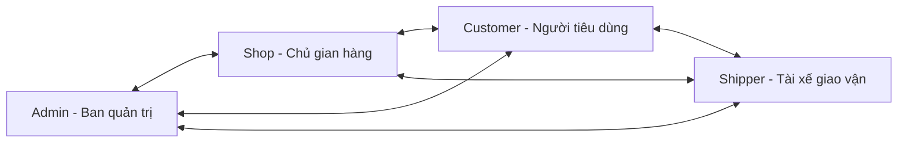

# FreshFlow — Báo cáo Tổng quan Dự án (Project Overview)

## Nền tảng Quản lý Tồn kho & Đặt hàng Nông sản Thực phẩm Thời gian thực
*(Real-time Inventory & Online Ordering Management Platform)*

> **Đề tài:** Xây dựng hệ thống quản lý tồn kho và đặt hàng trực tuyến theo thời gian thực  
> **Tên tiếng Anh:** Development of a Real-time Inventory and Online Ordering Management System  
> **Repository:** `FreshFlow`  
> **Trạng thái:** Đã hoàn thiện toàn bộ phân hệ chức năng, kiểm thử tự động đạt 100% và sẵn sàng vận hành.

---

## 1. Giới thiệu Dự án

**FreshFlow** là nền tảng thương mại điện tử chuyên biệt dành cho nông sản và thực phẩm tươi sạch theo ngày, kết nối trực tiếp giữa **Nhà nông / Chủ gian hàng (Shop)**, **Khách hàng tiêu dùng (Customer)**, **Đội ngũ giao vận (Shipper)** và **Ban điều phối (Admin)**.

Hệ thống giải quyết triệt để bài toán đặc thù của nông sản tươi:
- **Kiểm soát hạn sử dụng và số lượng thu hoạch theo ngày (Inventory Batches):** Không bán vượt số lượng thực tế trong kho.
- **Phân loại chính sách giá theo nhóm khách hàng (Group Pricing):** Ưu đãi đặc biệt cho Sinh viên, Người đi làm, Nhóm mua chung căn hộ và Khách hàng tập thể.
- **Mô hình giao nhận kép linh hoạt:** Vừa hỗ trợ **Điểm giao tập trung (Central Pickup)** giúp tiết kiệm chi phí vận chuyển cho sinh viên / cư dân, vừa hỗ trợ **Giao hàng tận nơi (Home Delivery)** qua Shipper thu hộ tiền mặt (COD).
- **Đồng bộ trạng thái tức thì (Real-time WebSockets):** Cập nhật biến động tồn kho, tiến độ đơn hàng và tin nhắn trò chuyện ngay lập tức không cần tải lại trang.

---

## 2. Các Phân hệ Vai trò (4 Core Roles)

### 2.1. Phân hệ Quản trị viên (Admin Portal)
- Bảng điều khiển tài chính & vận hành toàn sàn: Doanh thu thực nhận, tỷ lệ giao thành công, tăng trưởng tài khoản.
- Quản lý thành viên & phân quyền: Kích hoạt / khóa tài khoản, xác minh OTP, điều chỉnh nhóm khách hàng.
- Quản lý danh mục & cấu hình khung giờ giao hàng / điểm giao tập trung toàn sàn.
- Kiểm soát đơn hàng: Xem lịch sử chuyển đổi trạng thái của toàn bộ đơn hàng trên sàn, can thiệp điều phối khi cần.
- Quản lý chính sách thuế VAT: Thiết lập biểu thuế theo ngành hàng, xem lịch sử thay đổi mức thuế.
- Phát sóng thông báo (Broadcast Notifications) tức thì tới tất cả người dùng hoặc theo vai trò cụ thể.
- Kiểm duyệt nội dung tự động: Quản lý từ khóa vi phạm tiêu chuẩn cộng đồng, xem danh sách vi phạm.
- Nhật ký kiểm toán (Audit Logs) ghi nhận mọi hành vi quản trị quan trọng.

### 2.2. Phân hệ Cửa hàng (Shop Portal)
- Độc lập quản lý gian hàng (Multi-tenant): Quản lý sản phẩm riêng, nhập lô thu hoạch tồn kho theo ngày.
- Bảng tin Newfeed: Đăng bài giới thiệu món ngon trong ngày kèm chính sách giá ưu đãi cho từng nhóm.
- Quản lý đơn hàng phát sinh thuộc shop: Xác nhận đơn, chuẩn bị hàng, bàn giao tại điểm giao tập trung hoặc phân công Shipper.
- Đánh giá & Phản hồi: Xem và phản hồi trực tiếp các đánh giá của khách hàng cho sản phẩm của shop.
- Cách ly dữ liệu hoàn toàn: Cửa hàng mới tạo có dữ liệu độc lập, không thấy hoặc can thiệp đơn của shop khác.

### 2.3. Phân hệ Giao vận (Shipper Portal)
- Nhận đơn hàng được phân công hoặc chủ động nhận đơn đang sẵn sàng tại điểm tập kết.
- Cập nhật tiến độ giao hàng: Đã lấy hàng -> Đang di chuyển giao -> Đã giao thành công.
- Thu tiền mặt COD khi giao hàng và xác nhận số tiền thu hộ với hệ thống.
- Báo cáo thu nhập ca giao: Thống kê tổng số đơn hoàn thành và tiền mặt COD đã thu.

### 2.4. Phân hệ Khách hàng (Customer Storefront)
- Đăng ký tài khoản 2 bước qua mã OTP (Email / Số điện thoại).
- Khám phá nông sản tươi, xem giá ưu đãi theo nhóm khách hàng của mình.
- Đặt mua nhiều món trong một đơn, chọn địa chỉ nhận hàng, chọn điểm tập trung hoặc giao tận nơi, chọn khung giờ giao phù hợp.
- Hủy đơn hàng thuận tiện khi đơn chưa được duyệt và hệ thống tự động hoàn kho.
- Đánh giá chất lượng sản phẩm và đánh giá thái độ / tốc độ của tài xế giao hàng.
- Gửi yêu cầu tìm mặt hàng đặc thù khi chưa có sẵn trên sàn và nhận báo giá từ quản trị viên.
- Trò chuyện trực tiếp (Chat Realtime) với Cửa hàng và Shipper.

---

## 3. Kiến trúc Công nghệ

| Tầng công nghệ | Giải pháp được áp dụng | Mô tả chức năng |
|---|---|---|
| **Frontend Framework** | **Next.js 14 (App Router)** | Render giao diện nhanh chóng, quản lý route động, hỗ trợ đa vai trò |
| **Ngôn ngữ lập trình** | **TypeScript & Python 3.11+** | Đảm bảo tính nhất quán và chặt chẽ của kiểu dữ liệu |
| **Styling & Icons** | **Tailwind CSS + Font Awesome** | Giao diện hiện đại, tối ưu responsive trên Mobile và Desktop |
| **Backend Framework**| **FastAPI** | REST API hiệu năng cao, tự động sinh tài liệu OpenAPI / Swagger |
| **Realtime Engine** | **FastAPI WebSocket Manager** | Kênh truyền thông tin 2 chiều duy trì trạng thái liên tục |
| **Database & ORM** | **SQLite 3 / MySQL 8 + SQLAlchemy 2.0** | Quản lý 18 bảng thực thể quan hệ, kiểm soát giao dịch ACID an toàn |
| **Bảo mật & Mã hóa** | **Argon2 + JWT (HS256) + OTP 6 số** | Mã hóa mật khẩu một chiều, xác thực phiên làm việc an toàn |
| **Container hóa** | **Docker & Docker Compose** | Đóng gói toàn bộ frontend, backend và database sẵn sàng triển khai |

---

## 4. Danh sách Tài khoản Mẫu Kiểm thử (Demo Accounts)

| Vai trò | Email đăng nhập | Mật khẩu mặc định | Mô tả chi tiết |
|---|---|---|---|
| **ADMIN** | `admin@freshflow.example.com` | `FreshFlowAdmin123!` | Quản trị viên tối cao của sàn |
| **SHOP** | `shop@freshflow.example.com` | `FreshFlowShop123!` | Cửa hàng đối tác: Đà Lạt Green Farm |
| **SHIPPER** | `shipper@freshflow.example.com` | `FreshFlowDemo123!` | Tài xế giao vận: Nguyễn Văn Giao (49B1-88992) |
| **CUSTOMER** | `student@freshflow.example.com` | `FreshFlowDemo123!` | Khách hàng: Nguyễn Ngọc Anh (Nhóm Sinh viên) |
| **CUSTOMER** | `worker@freshflow.example.com` | `FreshFlowDemo123!` | Khách hàng: Trần Hoàng Nam (Nhóm Người đi làm) |

---

## 5. Hiện trạng & Kết quả Kiểm thử

- **Backend Pytest Suite:** Đạt **7/7 test suites** (100% PASSED).
- **Frontend Contract Integration:** Đạt **68/68 REST routes** và WebSocket.
- **Type Safety:** **0 lỗi** TypeScript (`tsc --noEmit`).
- **Production Build:** Biên dịch thành công 100% tất cả các trang và portal.
